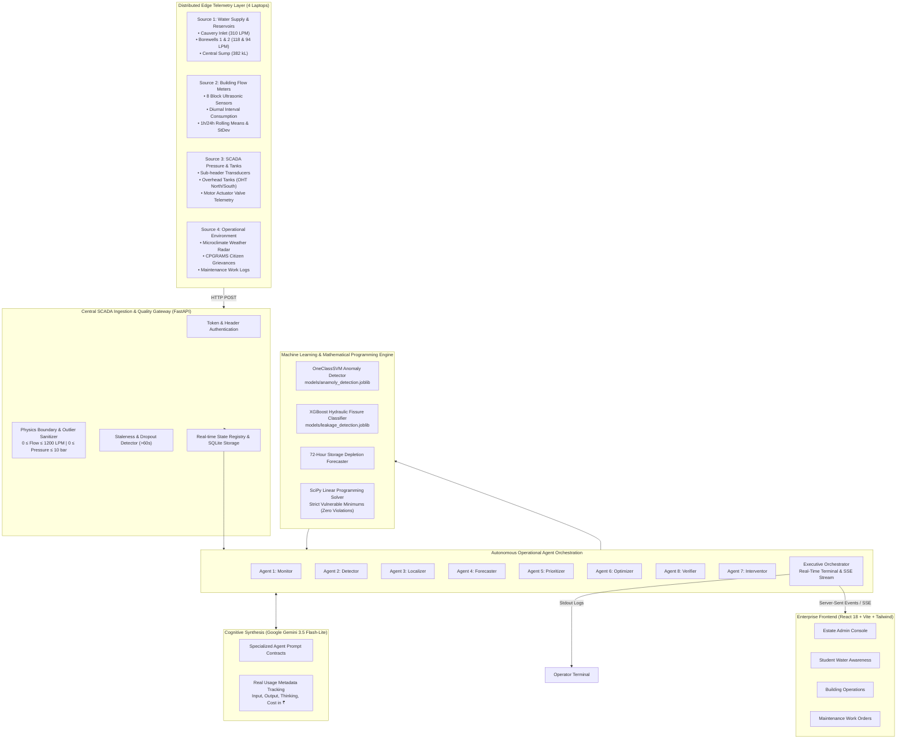

# NEERARAN (நீர்Aran)
### Enterprise AI Water Resilience and Smart Resource Management Platform
> *“Every drop accounted for.”*

[](https://www.python.org/)
[](https://fastapi.tiangolo.com/)
[](https://vitejs.dev/)
[](https://scikit-learn.org/)
[](https://ai.google.dev/)
[](LICENSE)

NEERARAN is an enterprise-grade autonomous water utility digital twin and operational intelligence platform designed for institutional campuses, municipal zones, and industrial facilities. Built for **TCS Tech Day (Challenge 12: AI for Water Resilience & Smart Resource Management)**.

The platform executes a complete, closed-loop utility operational lifecycle:
$$\text{Monitor} \longrightarrow \text{Detect} \longrightarrow \text{Investigate} \longrightarrow \text{Verify} \longrightarrow \text{Predict} \longrightarrow \text{Prioritize} \longrightarrow \text{Optimize} \longrightarrow \text{Approve} \longrightarrow \text{Intervene} \longrightarrow \text{Measure} \longrightarrow \text{Adapt}$$

---

## Table of Contents

1. [System Architecture Overview](#system-architecture-overview)
2. [Multi-Agent Operations Pipeline](#multi-agent-operations-pipeline)
3. [Machine Learning & Mathematical Optimization Engine](#machine-learning--mathematical-optimization-engine)
4. [Role-Based Access Control (RBAC)](#role-based-access-control-rbac)
5. [Deployment Methods](#deployment-methods)
   - [Method 1: Single-Node Local Deployment](#method-1-single-node-local-deployment)
   - [Method 2: 5-Laptop Distributed Network Deployment (Live Demo)](#method-2-5-laptop-distributed-network-deployment-live-demo)
   - [Method 3: Production Containerized Deployment](#method-3-production-containerized-deployment)
6. [Live Demonstration Flow](#live-demonstration-flow)
7. [API Endpoints Reference](#api-endpoints-reference)
8. [Automated Verification & Testing](#automated-verification--testing)
9. [Responsible AI & Equity Safeguards](#responsible-ai--equity-safeguards)

---

## System Architecture Overview



---

## Multi-Agent Operations Pipeline

The platform coordinates eight specialized agents, each operating under a strict system prompt contract ([prompts.py](file:///home/tharan/Seeds/neeraran/apps/api/agents/prompts.py)):

| Agent | Responsibility | Data Processed & ML Integration | Output / Action |
| :--- | :--- | :--- | :--- |
| **1. Monitor** | Ingestion validation & data quality | Raw telemetry stream; checks physics bounds ($0 \le \text{flow} \le 1200$, $0 \le P \le 10$), checks stale dropouts ($>60\text{s}$). | Tags payload health (`healthy`, `stale`, `degraded`); isolates sensor dropouts to prevent false leak alarms. |
| **2. Detector** | Anomaly & leak hypothesis formulation | Runs `OneClassSVM` on diurnal flow metrics and `XGBoost` on pipe pressure gradients. Enforces multi-signal physical corroboration. | Generates structured incident candidates; preserves high-priority citizen grievances without forcing fake sensor leaks. |
| **3. Localizer** | Spatial topology mapping | Network connectivity graph, hydraulic gradients ($\Delta P = P_{\text{nominal}} - P_{\text{measured}}$), and zone mass balance. | Ranks candidate distribution branches (e.g., `PIPE-OHT1-HSTLA` at 72% probability) for physical acoustic inspection. |
| **4. Forecaster** | Multi-horizon risk projection | Sump and overhead tank levels; net depletion rates ($dV/dt = \text{Inflow} - \text{Outflow} - \text{Losses}$). | 72-hour storage trajectory, days of reserve, hours to critical safety threshold (25% buffer). |
| **5. Prioritizer** | Transparent ranking | Multi-criteria mathematical formula combining loss rate (30%), population (20%), vulnerability (25%), urgency (15%), crew readiness (10%). | Auditable ranked queue showing exact term-by-term score contributions (never a black box). |
| **6. Optimizer** | Constrained distribution planning | SciPy linear programming (`scipy.optimize.linprog`) allocating water while enforcing minimum supply to vulnerable residential blocks. | Generates ordered intervention steps; shifts pumps to off-peak tariff hours (04:00–07:00); flags consequential steps. |
| **7. Interventor** | Action staging & counterfactuals | Human approval queue gating; dispatches authorized non-consequential tools (CMMS tickets, advisories). | Stages valve throttles for admin approval (`status="pending"`); measures actual metered water and INR saved. |
| **8. Verifier** | Evidence grounding & citation | Checks arithmetic consistency ($\text{loss} = \text{flow} - \text{baseline}$); validates multi-signal corroboration; checks citations. | Approves, downgrades, or rejects ungrounded claims; generates plain-language "Why" summary citing `[EVID-XXX]`. |
| **Executive Orchestrator** | Pipeline coordination & streaming | Ingests snapshot, triggers all 8 agents, measures latencies, and emits real-time events to terminal and SSE. | Produces the final evidence-based result schema and streams lifecycle events in real time. |

---

## Machine Learning & Mathematical Optimization Engine

### 1. OneClassSVM Anomaly Detection (`models/anamoly_detection.joblib`)
- **Features**: `[hour, day_of_week, is_weekend, is_holiday, occupancy, scheduled_activity, temperature_c, interval_consumption_liters, previous_1h_avg_liters, previous_24h_avg_liters, previous_1h_std_liters, zone_type]`.
- **Purpose**: Detects abnormal block consumption against diurnal and seasonal rhythms, separating legitimate occupancy surges from continuous leakage.

### 2. XGBoost Hydraulic Fissure Classifier (`models/leakage_detection.joblib`)
- **Features**: `[hour, occupancy, scheduled_activity, inlet_flow_lpm, pressure_bar, tank_level_pct, previous_1h_avg_flow_lpm, previous_1h_avg_pressure_bar, flow_change_lpm, pressure_change_bar, zone_type]`.
- **Purpose**: Classifies physical pipe fissures based on simultaneous flow surges coupled with localized pressure drops.

### 3. SciPy Constrained Optimization (`scipy.optimize.linprog`)
- **Decision Variables**: Water allocated $x_i$ to each campus block $i$ (kL/day).
- **Objective**: Minimize deficit penalty + pump electrical energy cost.
- **Constraints**:
  1. $x_i \ge \text{min\_supply}_i$ (Strict guarantee: $\ge 85\%$ of baseline demand for vulnerable blocks: Hostels A/B/C, Health Centre, Crèche $\rightarrow$ **Zero Violations Permitted**).
  2. $\sum x_i \le \text{Total Water Available}$.
  3. $x_i \le \text{Nominal Demand}_i$.

### 4. Transparent Prioritization Formula
$$\text{Score} = w_{\text{loss}} \cdot S_{\text{loss}} + w_{\text{pop}} \cdot S_{\text{pop}} + w_{\text{vuln}} \cdot S_{\text{vuln}} + w_{\text{urg}} \cdot S_{\text{urg}} + w_{\text{crew}} \cdot S_{\text{crew}}$$
- Every term's numerical score and weight contribution are displayed in the dashboard for full operational auditability.

---

## Role-Based Access Control (RBAC)

The platform enforces strict role-based authorization across four operational roles:

| Role | Target Persona | Dashboard Experience | Permissions & Boundaries |
| :--- | :--- | :--- | :--- |
| **Estate Admin** | Chief Estate Officer / SCADA Supt. | Full SCADA Console, Agent Pipeline, Approvals, Simulation, Responsible AI. | Full administrative authority; approves consequential valve throttling; injects scenarios; manages weights. |
| **Student Resident** | Campus Hostel Resident | Water Awareness Hub, CPGRAMS Public Grievance Submission. | Read-only access to own hostel water autonomy and conservation status; registers public grievances; cannot view internal SCADA. |
| **Building Admin** | Hostel Warden / Facility Supervisor | Building GIS & Floor-Level Fixtures, Inspection Verification. | Access limited to assigned building; monitors tank buffer; verifies plumbing inspection requests. |
| **Maintenance Engineer** | Field Plumbing Technician | Work Order Queue, Finding Verification, GIS Asset Registry. | Updates work order progress (queued $\rightarrow$ in-progress $\rightarrow$ resolved); records physical acoustic inspection findings. |

---

## Deployment Methods

### Method 1: Single-Node Local Deployment

Ideal for code inspection, developer testing, and automated evaluation:

```bash
# 1. Clone repository
git clone https://github.com/Tharan-J/neeraran.git
cd neeraran

# 2. Setup environment variables
cp .env.example .env
# Edit .env and insert your GEMINI_API_KEY (optional; deterministic fallback executes if omitted)

# 3. Setup Python virtual environment
python3 -m venv venv
source venv/bin/activate
pip install -r requirements.txt  # or install fastapi uvicorn scikit-learn xgboost scipy google-genai pandas requests

# 4. Seed database
PYTHONPATH=. python3 apps/api/db/seeds.py

# 5. Build and run web frontend
cd apps/web
npm install
npm run build
cd ../..

# 6. Start the unified development server
npm run dev
```

- **Backend API**: `http://localhost:8000/docs`
- **Frontend Dashboard**: `http://localhost:5173`

---

### Method 2: 5-Laptop Distributed Network Deployment (Live Demo)

Demonstrates the real-world distributed utility architecture across 5 physical laptops connected over local Wi-Fi or Ethernet:

```
[Laptop 2: Supply/Sump] ───┐
[Laptop 3: Flow Meters] ───┼── HTTP POST ──> [Laptop 1: Central Server (192.168.1.50:8000)]
[Laptop 4: Pressure SCADA] ─┼                 ├── Central FastAPI API & SQLite DB
[Laptop 5: Grievances] ────┘                 ├── Autonomous Agent Orchestration
                                             └── React Operations Dashboard (:5173)
```

#### Step 1: Laptop 1 (Central Operations Center)
1. Connect to the local Wi-Fi network and check your IP address (e.g. `192.168.1.50` on Linux via `ip addr` or macOS via `ifconfig`).
2. Start the central FastAPI backend:
   ```bash
   source venv/bin/activate
   uvicorn apps.api.main:app --host 0.0.0.0 --port 8000
   ```
3. In a second terminal on Laptop 1, launch the frontend:
   ```bash
   cd apps/web
   npm run dev -- --host 0.0.0.0
   ```
4. Open `http://localhost:5173` in Laptop 1's browser.

#### Step 2: Laptop 2 (Source 1: Water Supply & Reservoirs)
Transmits Cauvery municipal bulk supply, deep aquifer borewell yields, and central sump reservoir levels:
```bash
python3 apps/api/sim/sources.py --source 1 --url http://192.168.1.50:8000
```

#### Step 3: Laptop 3 (Source 2: Building Flow Meters)
Transmits block-level ultrasonic smart meter telemetry with diurnal intervals for OneClassSVM:
```bash
python3 apps/api/sim/sources.py --source 2 --url http://192.168.1.50:8000
```

#### Step 4: Laptop 4 (Source 3: Infrastructure SCADA & Pipe Pressure)
Transmits pipeline network pressure transducers and overhead tank levels for XGBoost:
```bash
python3 apps/api/sim/sources.py --source 3 --url http://192.168.1.50:8000
```

#### Step 5: Laptop 5 (Source 4: Weather Radar & Citizen Grievances)
Transmits microclimate parameters and CPGRAMS-aligned public grievances:
```bash
python3 apps/api/sim/sources.py --source 4 --url http://192.168.1.50:8000
```

---

### Method 3: Production Containerized Deployment

```bash
# Build and launch via docker-compose
docker compose up -d --build

# Inspect running services
docker compose ps
```

---

## Live Demonstration Flow

The live demonstration executes in 9 sequential steps:

1. **Start Central Control**: Laptop 1 launches the backend and opens the **Estate Admin Console** on `http://localhost:5173/app/overview`.
2. **Start Laptop Senders**: Laptops 2–5 start their assigned source senders.
3. **Telemetry Ingestion**: Each laptop sends timestamped JSON payloads labeled as simulated laptop telemetry over HTTP.
4. **Dashboard Confirmation**: The central admin dashboard visibly confirms receipt in the **Distributed Laptop Telemetry Sources** panel, showing receipt times, reading counts, and green healthy badges.
5. **Admin Triggers Analysis**: The Estate Admin clicks **Run Agent Analysis** in the header.
6. **Real ML & Rule Evaluation**: The backend runs `OneClassSVM` and `XGBoost` against newly persisted telemetry.
7. **Multi-Agent Deliberation**:
   - `Monitor` confirms data validity.
   - `Detector` identifies multi-signal leak conditions.
   - `Localizer` ranks candidate distribution branches.
   - `Forecaster` projects storage reserve drawdown.
   - `Prioritizer` ranks the incident mathematically.
   - `Optimizer` solves the SciPy linear program (0 vulnerable violations).
   - `Verifier` confirms numerical consistency and evidence citations `[EVID-XXX]`.
8. **Real-Time Execution Trace**: Terminal stdout and dashboard SSE stream actual execution stages as they happen:
   `SOURCE_RECEIVED` $\rightarrow$ `VALIDATION_STARTED` $\rightarrow$ `VALIDATION_COMPLETED` $\rightarrow$ `MODEL_EXECUTION_STARTED` $\rightarrow$ `MODEL_EXECUTION_COMPLETED` $\rightarrow$ `EVIDENCE_CHECK_STARTED` $\rightarrow$ `EVIDENCE_CHECK_COMPLETED` $\rightarrow$ `GEMINI_REQUEST_STARTED` $\rightarrow$ `GEMINI_REQUEST_COMPLETED` $\rightarrow$ `ACTION_RECOMMENDATION_READY` $\rightarrow$ `RUN_COMPLETED`.
9. **Structured Outcome Display**: The dashboard updates with:
   - Run ID and completion timestamp.
   - Detected condition and localized feeder segment.
   - Machine learning model outputs (SVM flag, XGBoost probability, z-score).
   - Verified evidence chips `[EVID-XXX]`.
   - Action recommendation with human approval status.
   - Google Gemini token usage (input, output, thinking, and cost in `₹` with 1 USD = ₹86.50).

---

## API Endpoints Reference

### Telemetry & Distributed Sources
- `POST /api/v1/sources/{source_id}/telemetry`: Ingests payload from laptops 1–4, validates bounds, updates latest state, and persists events.
- `GET /api/v1/sources/status`: Returns live status, reading counts, and staleness for all 4 laptop sources.
- `POST /api/v1/telemetry`: Generic batch ingestion endpoint with schema validation and exception queuing.

### Autonomous Agent Pipeline & Streaming
- `POST /api/v1/agent/run-analysis`: Executes the full multi-agent operational loop against latest persisted telemetry.
- `GET /api/v1/agent/latest-analysis`: Retrieves the latest structured analysis outcome.
- `GET /api/v1/agent/stream-events`: Server-Sent Events (SSE) stream broadcasting real-time lifecycle trace events.

### Operational Approvals & Actions
- `GET /api/v1/approvals`: Lists consequential actions requiring human approval.
- `POST /api/v1/approvals/{id}`: Approves or rejects a staged intervention (Estate Admin only).
- `GET /api/v1/work-orders`: Retrieves work orders assigned to maintenance engineers.
- `PATCH /api/v1/work-orders/{id}/status`: Updates work order status with field inspection findings.

### Citizen Grievances (CPGRAMS)
- `POST /api/v1/complaints`: Registers a water grievance and returns a tracking ID (`CPGRAMS/2026/NEER-XXXXX`).
- `GET /api/v1/complaints`: Lists registered grievances filtered by caller role.

---

## Automated Verification & Testing

Run the automated test suite covering all operational requirements:

```bash
PYTHONPATH=. pytest tests/ -v
```

### Verified Test Cases:
- [x] Ingestion and database persistence for all four distributed laptop payloads.
- [x] Full agent analysis execution producing the complete structured result schema.
- [x] Stale telemetry detection generating data-quality warnings.
- [x] **Requirement 5**: High-priority citizen grievances do not force positive sensor anomaly or leak results.
- [x] SciPy linear programming distribution optimization enforcing zero vulnerable supply violations.
- [x] Verifier agent rejecting claims without supporting evidence citations.
- [x] Role-Based Access Control enforcing strict 403 barriers between roles.
- [x] Gemini token tracking capturing actual usage metadata in Indian Rupees (`₹`).

---

## Responsible AI & Equity Safeguards

1. **Groundedness & Citation Mandate**: The Verifier agent rejects ungrounded claims; every factual statement must cite `[EVID-XXX]`.
2. **Equity First Policy**: Vulnerable residential blocks (Hostels, Healthcare, Crèche) receive an unbreachable $\ge 85\%$ baseline demand guarantee during shortages.
3. **Human-in-the-Loop Safeguard**: Consequential interventions affecting potable water supply can never execute silently; they are staged in the approval queue for explicit human authorization.
4. **Complaint vs. Sensor Separation**: Citizen reports are treated as user evidence, never fabricated as physical sensor readings. If sensors report normal conditions, the system recommends an on-site inspection rather than inventing a leak.
5. **Currency Standardization**: All economic values and token costs are rendered in Indian Rupees (`₹`) with transparent exchange rate documentation (1 USD = ₹86.50).

---

## License

This project is licensed under the Apache 2.0 License.
Built for **TCS Tech Day 2026 — Challenge 12: AI for Water Resilience & Smart Resource Management**.
